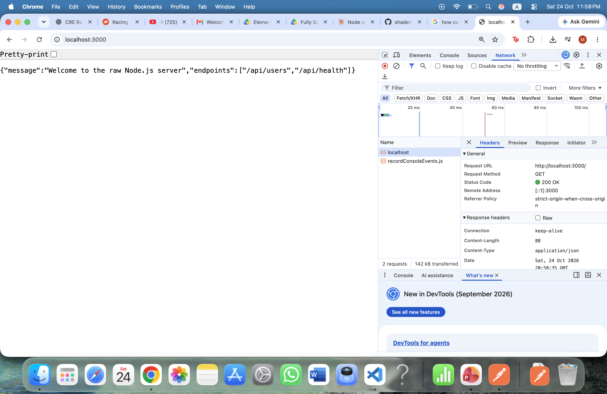
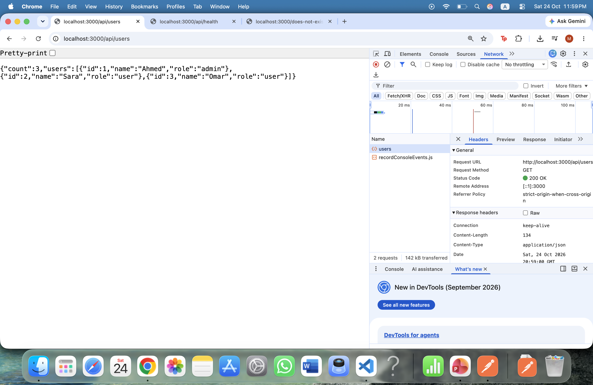
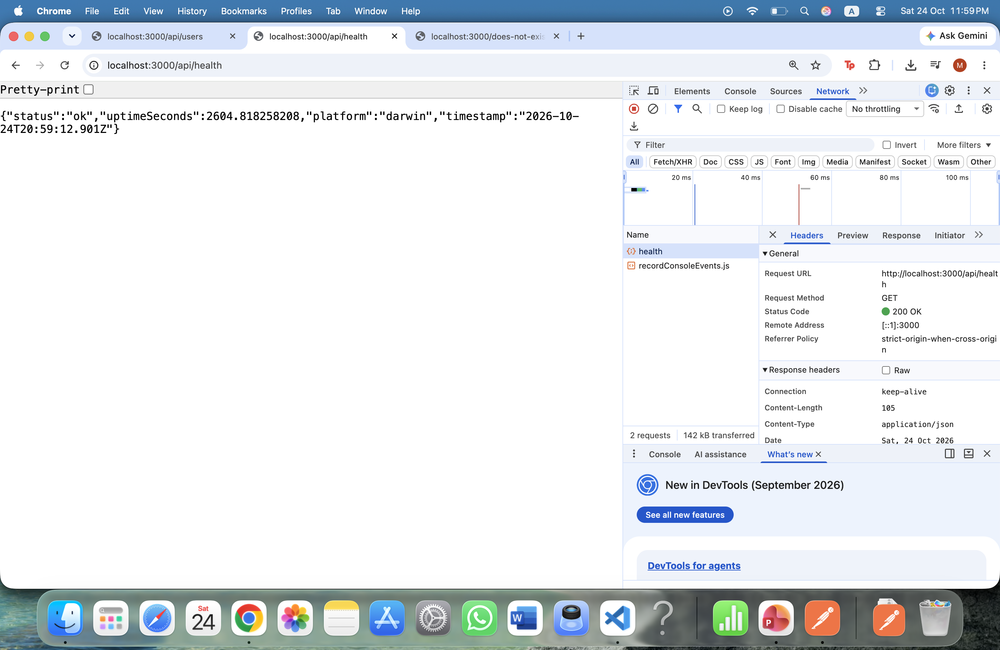
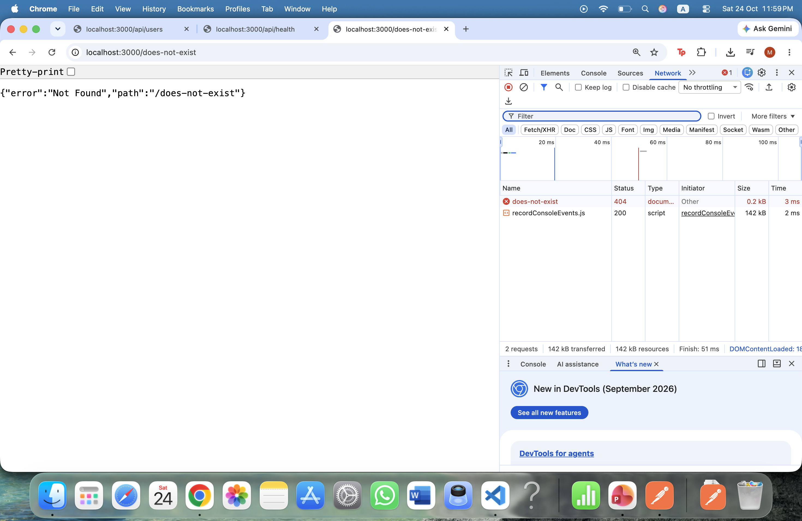
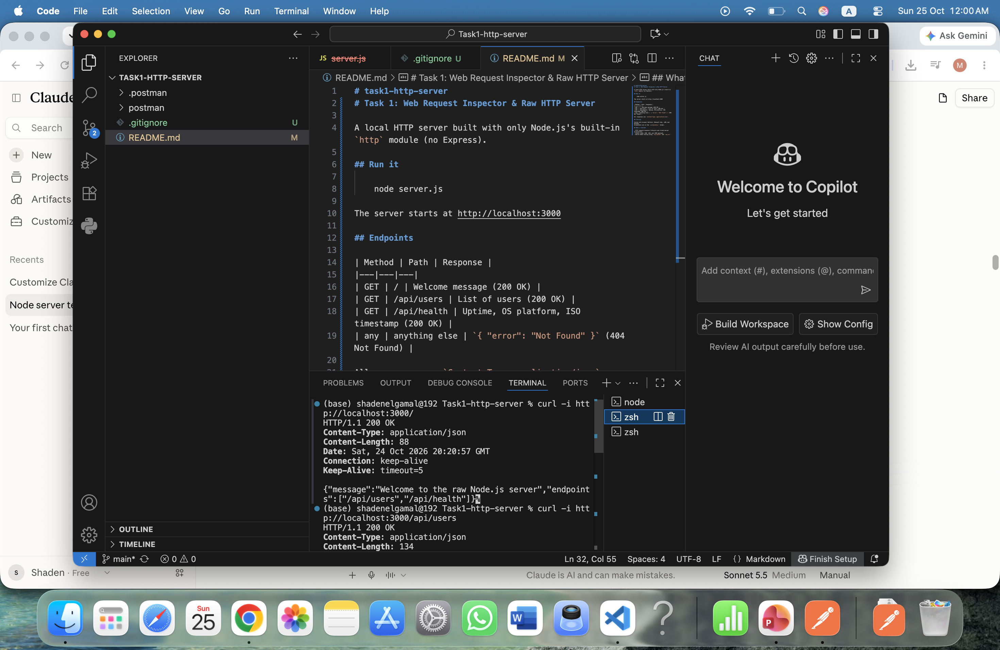
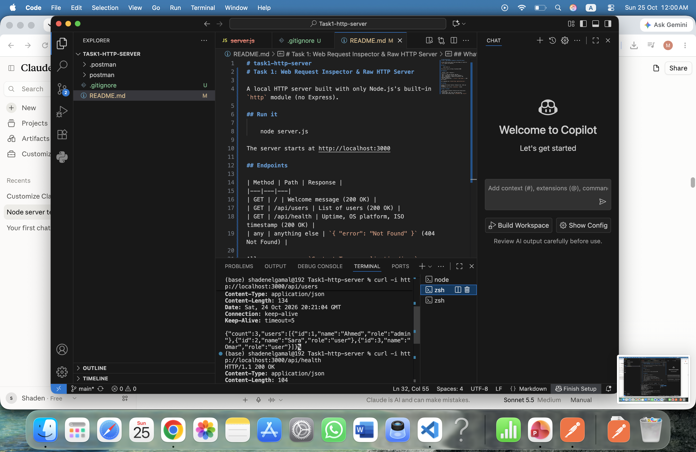
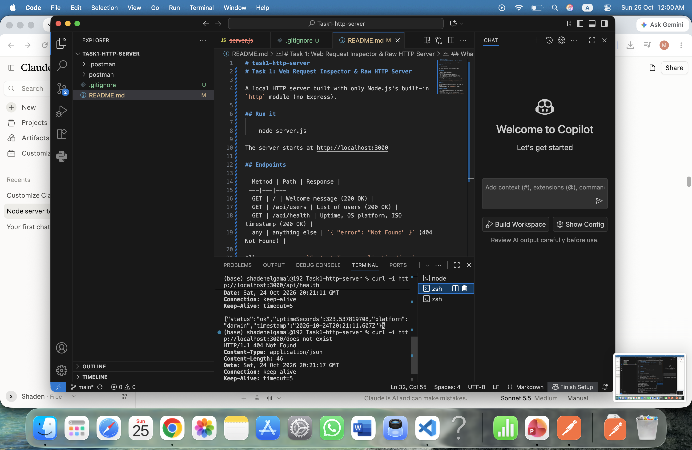
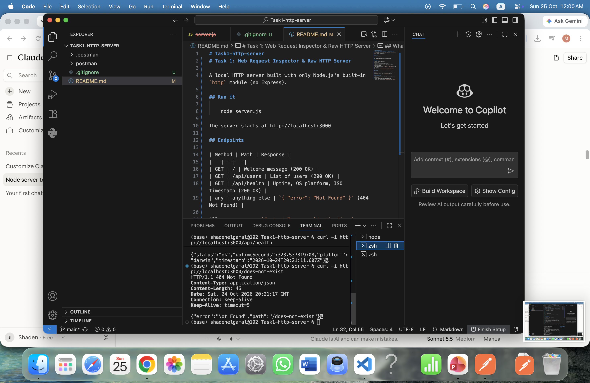
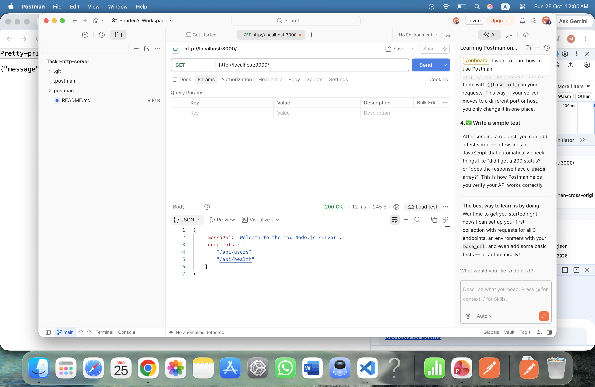
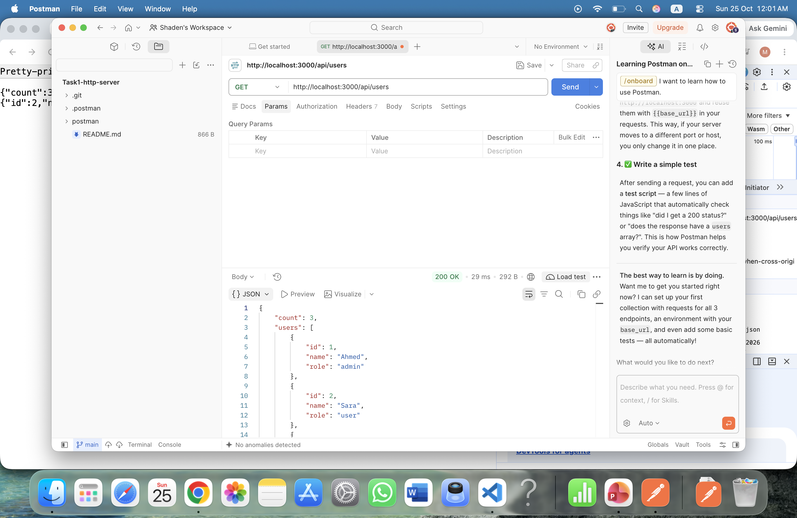

# task1-http-server
# Task 1: Web Request Inspector & Raw HTTP Server

A local HTTP server built with only Node.js's built-in `http` module (no Express).

## Run it

    node server.js

The server starts at http://localhost:3000

## Endpoints

| Method | Path | Response |
|---|---|---|
| GET | / | Welcome message (200 OK) |
| GET | /api/users | List of users (200 OK) |
| GET | /api/health | Uptime, OS platform, ISO timestamp (200 OK) |
| any | anything else | `{ "error": "Not Found" }` (404 Not Found) |

All responses use `Content-Type: application/json`.

## Testing

Tested with browser DevTools (Network tab), cURL and Postman.
Screenshots are in the `screenshots/` folder.

## What I learned

- HTTP request/response lifecycle and client-server architecture
- Status codes (200, 404) and JSON payloads
- Native Node routing using `req.method` and `req.url`
## Screenshots

### Browser DevTools

### cURL

### Postman

